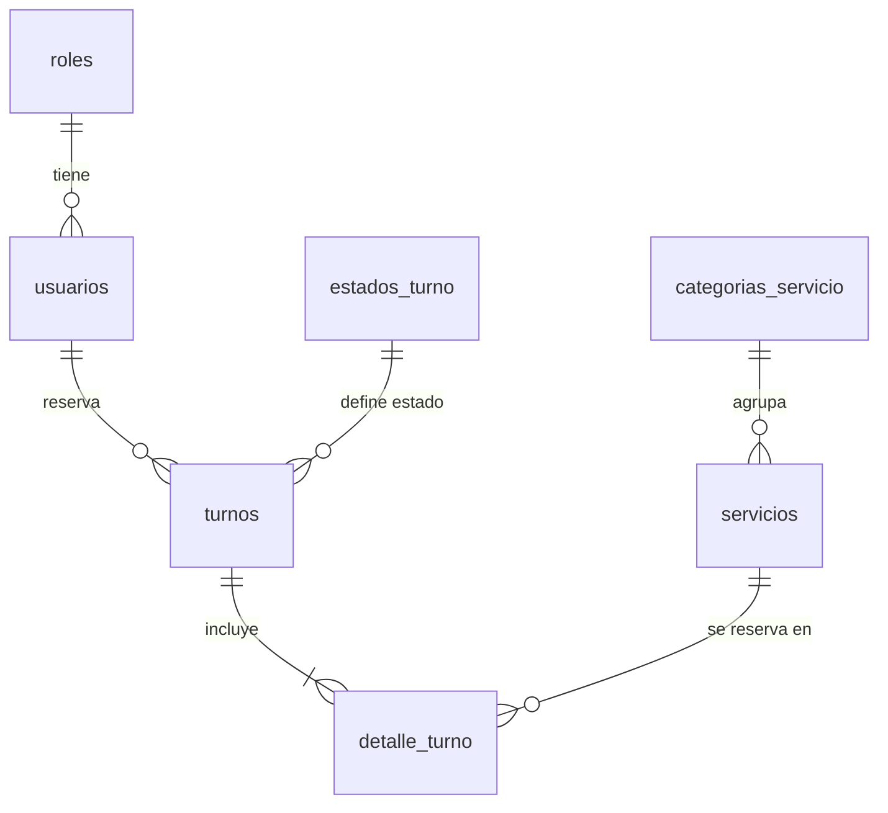

# TP6 – Normalización del proyecto Tanianailsart

Sistema web de turnos para un estudio de uñas. Una clienta reserva un turno y elige uno o más servicios.

---

## 1. Entidad principal sin normalizar

Registro hipotético de un turno tal como se podría guardar en una sola tabla `turnos_sin_normalizar`:

| id_turno | clienta | email | telefonos | rol | fecha_hora | estado | servicios | categorias | precios |
|---|---|---|---|---|---|---|---|---|---|
| 1 | Sofía Rodríguez | sofia@mail.com | 3875550002, 3875559999 | clienta | 2026-11-05 10:00 | pendiente | Uñas esculpidas, Diseño artístico | Esculpidas, Diseño | 18000, 8000 |

**Problemas detectados**

- **Campos multivalorados:** `telefonos`, `servicios`, `categorias` y `precios` guardan varias cosas en una sola celda.
- **Redundancia:** si Sofía reserva 10 turnos, se repiten su nombre, email, teléfonos y rol 10 veces. Si cambia su email hay que modificarlo en todos los registros.
- **Anomalías:** no se puede cargar un servicio nuevo sin turno (inserción), si se borra el único turno de un servicio se pierde su precio (borrado) y cambiar un precio obliga a tocar muchas filas (actualización).

---

## 2. Proceso de normalización

### Primera Forma Normal (1FN)

**Regla:** cada campo debe ser atómico, sin listas ni grupos repetitivos.

Se separa cada valor múltiple en su propia fila. La clave pasa a ser compuesta: `(id_turno, servicio)`.

| id_turno | clienta | email | telefono | rol | fecha_hora | estado | servicio | categoria | precio |
|---|---|---|---|---|---|---|---|---|---|
| 1 | Sofía Rodríguez | sofia@mail.com | 3875550002 | clienta | 2026-11-05 10:00 | pendiente | Uñas esculpidas | Esculpidas | 18000 |
| 1 | Sofía Rodríguez | sofia@mail.com | 3875550002 | clienta | 2026-11-05 10:00 | pendiente | Diseño artístico | Diseño | 8000 |

Además, el teléfono pasa a ser un solo dato por usuario (`telefono`) para mantener la atomicidad.

### Segunda Forma Normal (2FN)

**Regla:** estar en 1FN y que ningún atributo no-clave dependa solo de una **parte** de la clave compuesta.

Clave: `(id_turno, servicio)`. Dependencias funcionales:

- `id_turno → clienta, email, telefono, rol, fecha_hora, estado` (dependen solo del turno).
- `servicio → categoria, precio` (dependen solo del servicio).

Hay dependencias parciales, así que se descompone en tres tablas:

- **turnos**(**id_turno**, clienta, email, telefono, rol, fecha_hora, estado)
- **servicios**(**id_servicio**, nombre, categoria, precio)
- **detalle_turno**(**id_turno**, **id_servicio**, precio_aplicado)

### Tercera Forma Normal (3FN)

**Regla:** estar en 2FN y que no existan dependencias transitivas (un atributo no-clave que depende de otro no-clave).

Dependencias transitivas encontradas:

| Tabla | Dependencia transitiva | Solución |
|---|---|---|
| turnos | `id_turno → email → clienta, telefono, rol` (los datos de la persona dependen del email/usuario, no del turno) | Tabla **usuarios** |
| usuarios | `id_usuario → rol` (texto repetido) | Tabla **roles** |
| turnos | `id_turno → estado` (texto repetido y sin control) | Tabla **estados_turno** |
| servicios | `id_servicio → categoria` (texto repetido) | Tabla **categorias_servicio** |

El `precio_aplicado` en `detalle_turno` se conserva a propósito: guarda el precio del servicio **al momento de reservar**, para no alterar el historial si el precio cambia después. No es redundancia, es un dato histórico.

---

## 3. Tablas resultantes

| Tabla | PK | FK |
|---|---|---|
| **roles** | `id` | – |
| **categorias_servicio** | `id` | – |
| **estados_turno** | `id` | – |
| **usuarios** | `id` | `rol_id` → roles.id |
| **servicios** | `id` | `categoria_id` → categorias_servicio.id |
| **turnos** | `id` | `usuario_id` → usuarios.id, `estado_id` → estados_turno.id |
| **detalle_turno** | `id` (único `turno_id + servicio_id`) | `turno_id` → turnos.id, `servicio_id` → servicios.id |

### Diagrama

La relación **turnos ↔ servicios** es muchos-a-muchos (N:M) y se resuelve con la tabla `detalle_turno`.

---

## Archivos del trabajo

- [`schema.sql`](./schema.sql): creación de la base de datos, tablas, claves, auditoría e índices.
- [`consultas.sql`](./consultas.sql): pruebas CRUD (INSERT, SELECT con WHERE/ORDER BY, INNER JOIN, UPDATE y DELETE).

**Cómo ejecutarlos:** en phpMyAdmin (o WampServer/XAMPP) importar primero `schema.sql` y después `consultas.sql`.
