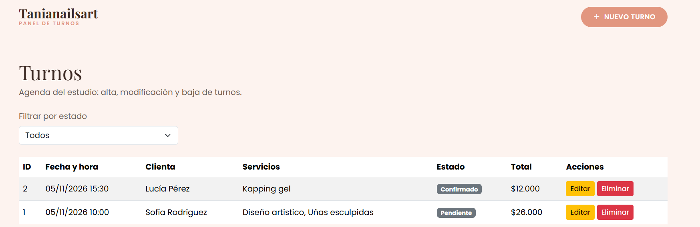
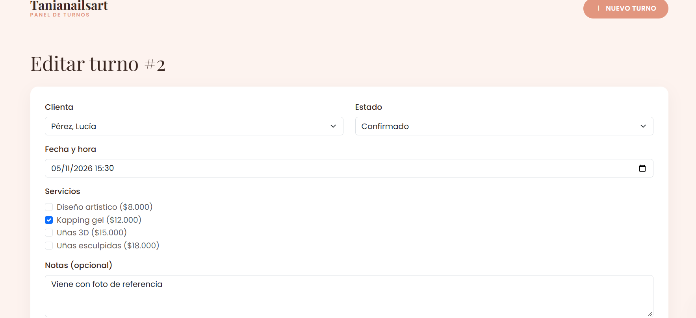
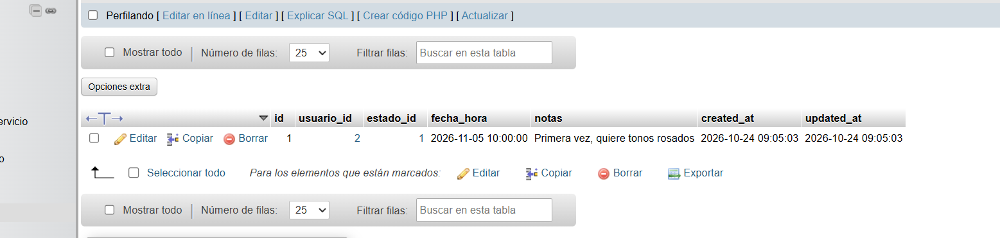

# TP7 – Persistencia y conexión PHP-MySQL segura

CRUD de **turnos** del sitio Tanianailsart, integrado al layout (Bootstrap + estilos propios) y a la base de datos diseñada en el TP6.

## Estructura

```
tp7/
├── config/conexion.php        Conexión PDO con try-catch (PDOException)
├── includes/
│   ├── header.php, footer.php Plantilla modular
│   ├── funciones.php          h() para XSS, validaciones, helpers
│   └── form_turno.php         Formulario compartido (crear y editar)
├── admin/
│   ├── index.php              READ   – listado + filtro por estado
│   ├── crear.php              CREATE – formulario + inserción
│   ├── editar.php             UPDATE – formulario precargado + actualización
│   └── eliminar.php           DELETE – baja (solo por POST)
├── css/estilos.css
└── sql/
    ├── schema.sql             Estructura de la base (TP6)
    └── datos_prueba.sql       Datos iniciales
```

## Seguridad aplicada

- **Consultas preparadas** con marcadores `:nombre` / `?` en todas las lecturas, altas, modificaciones y bajas (`PDO::ATTR_EMULATE_PREPARES => false`).
- **XSS:** todo valor impreso en HTML pasa por `htmlspecialchars()` (función `h()`).
- **Validación en servidor** de cliente, estado, fecha/hora, servicios y largo de las notas; los datos escritos se conservan si hay errores.
- **Transacciones** al guardar el turno y su detalle (`beginTransaction` / `commit` / `rollBack`).
- **Horario ocupado:** se captura el error de clave única (`23000`) y se informa al usuario.
- **Borrado por POST** con confirmación, no por enlace GET.
- Los errores técnicos se registran con `error_log()`; al usuario se le muestra un mensaje genérico.

## Cómo ejecutarlo (WampServer / XAMPP)

1. Copiar la carpeta `tp7` en `C:\wamp64\www\` (o `C:\xampp\htdocs\`).
2. Iniciar Apache y MySQL.
3. En phpMyAdmin, pestaña **Importar**: primero `sql/schema.sql`, después `sql/datos_prueba.sql`.
4. Abrir http://localhost/tp7/admin/

Si el usuario `root` de MySQL tiene contraseña, editarla en `config/conexion.php`.

## Capturas






